<picture>
  <source media="(prefers-color-scheme: dark)" srcset="./assets/header-dark.svg">
  <source media="(prefers-color-scheme: light)" srcset="./assets/header-light.svg">
  
</picture>


### Oi, eu sou o Kauã 👋

Lidero **Customer Success** e vivo no cruzamento entre **dados, operações e tecnologia**.
Estudo **Ciências Econômicas** na UEL e, nas horas vagas, construo sites no **[mwllo.dev](https://mwllo.dev)**.

<sub>🇺🇸 Customer Success lead, economics student and web builder. Data-driven, AI-curious.</sub>

<br clear="right">

```ts
const kaua = {
  papel: "Líder de Customer Success",
  carteira: { mrr: "~R$ 2 mi", clientes: "1.200+ (maioria escritórios contábeis)" },
  retencaoDeReceita2026: "95%+",
  estudando: "Ciências Econômicas @ UEL",
  fundador: "mwllo.dev — estúdio de criação de sites",
  interesses: ["Dados", "CS Ops", "IA", "Tech"],
  offline: ["Santos FC 🐳", "Counter-Strike 🎯", "Anime", "Leitura"],
  lendo: "Antifrágil — Nassim Nicholas Taleb",
};
```

### 🛠️ Ferramentas que aparecem nos meus repos


### 🚧 No que estou construindo

| Projeto | O que é |
|---|---|
| 🧱 **[mwllo.dev](https://mwllo.dev)** | Estúdio de criação de sites sob medida — veja os [exemplos](https://exemplos.mwllo.dev) |
| ✍️ **[kaua-melo.com](https://kaua-melo.com)** | Meu canto pessoal: economia, tecnologia, IA e CS |
| 📁 **[portfolio.kaua-melo.com](https://portfolio.kaua-melo.com)** | Portfólio profissional |

### 🧩 Apps que fiz para uso próprio

Ferramentas que comecei para resolver coisas do meu dia a dia. O código está aberto.

| App | O que é |
|---|---|
| 📓 **[Caderno](https://github.com/meninbom/caderno-desktop)** | App de anotações para Windows com tarefas, calendário, clipper e transcrição de áudio local |
| 🎼 **[Orquestra](https://github.com/meninbom/orquestra)** | Quadro branco para desenhar e apresentar diagramas animados, no navegador ou no Windows |
| 📸 **[Capturo](https://github.com/meninbom/capturo)** | Ferramenta de print para Windows no estilo Lightshot, num `.exe` de 80 KB |

### 📫 Bora conversar

[](https://kaua-melo.com)
[](https://portfolio.kaua-melo.com)
[](mailto:contato@mwllo.dev)

<p align="center"><sub>“O vento apaga uma vela, mas aviva o fogo.” — tirado de <i>Antifrágil</i> · feito com ☕ e dados</sub></p>
